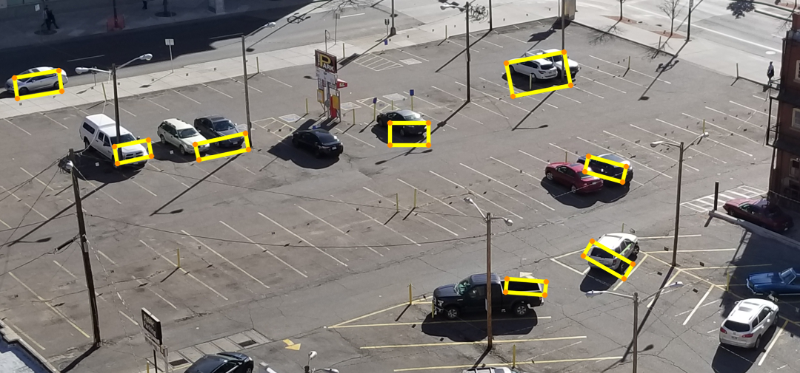
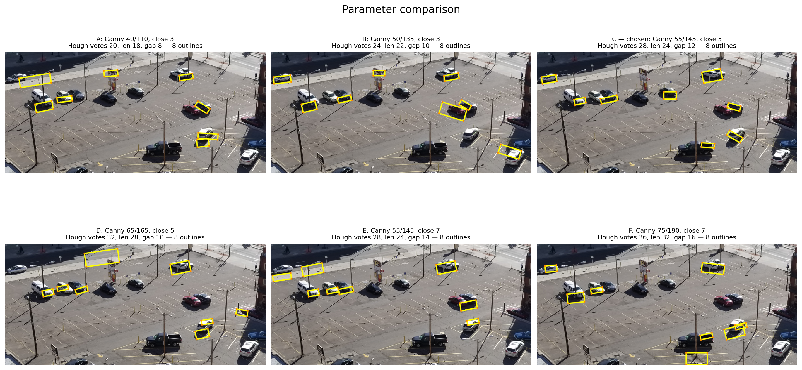

# Aerial vehicle outline detection

An explainable OpenCV pipeline for finding approximate vehicle rectangles in an aerial parking-lot photograph. The project includes an executed Jupyter notebook, saved result images, and an interactive Streamlit demo designed for a short classroom presentation.



## Interactive demo

The Streamlit app exposes the Canny, morphology, and probabilistic Hough parameters and updates the result live. It also includes the full processing pipeline, the six-setting comparison grid, limitations, and a 60-second presentation flow.

```bash
python -m venv .venv
source .venv/bin/activate
pip install -r requirements.txt
streamlit run app.py
```

Open the URL printed by Streamlit, normally <http://localhost:8501>.

For a classroom demo:

1. Start on **Live result** and describe the input and eight retained outlines.
2. Open **Pipeline stages** and walk from grayscale through Hough segments.
3. Lower the Canny thresholds in the sidebar to show pavement clutter.
4. Select **Reset chosen settings** and open **Parameter study**.
5. Finish with **Method & presentation** to discuss incomplete detections and false negatives.

## Method

The source is cropped reproducibly at `(480, 690, 2640, 1700)` in the 4032 × 3024 original and resized to 50%. The selected pipeline uses:

- grayscale conversion and a 5 × 5 Gaussian filter;
- Canny thresholds `(55, 145)`;
- morphological closing with a 5 × 5 rectangular kernel;
- `HoughLinesP` with 28 votes, minimum length 24, and maximum gap 12;
- pairing of nearby, overlapping line segments with directions within 9°;
- vehicle-scale size and aspect-ratio checks;
- interior edge-density, grayscale variation, and local-contrast checks; and
- border rejection and rotated-rectangle overlap suppression.

The yellow boxes are approximate outlines because vehicle bodies are rounded, affected by perspective, and partly hidden by glare or shadow.

## Results and limitations

The selected setting retains eight vehicle-aligned rectangles while rejecting obvious parking-stripe-only rectangles. Some boxes follow roof or body edges rather than the complete bumper-to-bumper silhouette. The adjacent red and dark vehicles are difficult to separate, and one dark vehicle is missed because its side blends into its shadow.



## Repository contents

| Path | Purpose |
|---|---|
| `app.py` | Interactive Streamlit presentation |
| `vehicle_detector.py` | Reusable OpenCV pipeline used by the app |
| `vehicle_rectangle_detection.ipynb` | Executed analysis notebook |
| `generate_notebook.py` | Recreates the notebook source |
| `data/parking_lot_original.jpg` | Downloaded Wikimedia Commons source |
| `results/` | Crop, intermediate stages, comparison, and final overlay |
| `requirements.txt` | Reproducible Python dependencies |

## Notebook

Launch the notebook with Jupyter, or execute it non-interactively:

```bash
jupyter execute vehicle_rectangle_detection.ipynb --inplace
```

The notebook verifies that all required output images exist at the end of the run.

## Photograph credit

**Heath Alseike**, [*Above the Parking Lot (24993869647).jpg*](https://commons.wikimedia.org/wiki/File:Above_the_Parking_Lot_(24993869647).jpg), 20 January 2018. Licensed under [CC BY 2.0](https://creativecommons.org/licenses/by/2.0/). The photograph was cropped, resized, processed, and annotated for this project.
